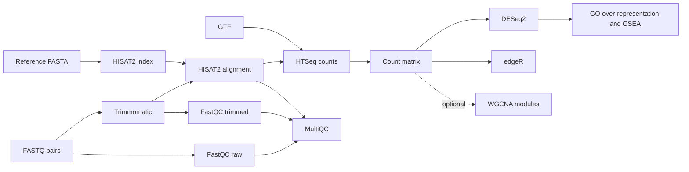

# RNA-seq analysis with Nextflow

A modular Nextflow DSL2 workflow for paired-end RNA-seq: read QC, trimming, alignment, gene counts, differential expression, GO enrichment, and optional WGCNA co-expression modules.

## Workflow



## Quick start

Requires Nextflow 24.04 or later and Docker. The Docker profile uses Nextflow Wave to build process containers from the pinned Conda environments. GO/GSEA downloads the latest human GAF and GO ontology from the [Gene Ontology Consortium](https://geneontology.org/docs/download-go-annotations/).

```bash
nextflow run abhijitswain09/NGS-data-analysis -profile docker \
  --input samplesheet.csv \
  --fasta genome.fa \
  --gtf genes.gtf \
  --strandedness reverse \
  --outdir results
```

The default contrast compares `treatment` against `control`. For other condition labels, set `--contrast_reference` and `--contrast_target`. The default GO annotations are human. To use another organism, select its current GAF from the [GO annotation downloads](https://geneontology.org/docs/download-go-annotations/downloads/) and pass its URL with `--go_annotation_url`. The GTF must include `gene_id` and `gene_name` attributes that match the annotation symbols.

To skip the internet-dependent GO/GSEA stage, add `--skip_go true`. The optional WGCNA stage needs at least 15 samples and can be enabled with `--run_wgcna true`.

For a local clone, replace the repository name with `.`. The alternative `-profile conda` requires Conda or Mamba.

## Samplesheet

One row per sample; paired-end FASTQ paths can be local paths or URLs:

```csv
sample,fastq_1,fastq_2,condition
CTRL_1,/data/ctrl1_R1.fastq.gz,/data/ctrl1_R2.fastq.gz,control
CTRL_2,/data/ctrl2_R1.fastq.gz,/data/ctrl2_R2.fastq.gz,control
TREAT_1,/data/trt1_R1.fastq.gz,/data/trt1_R2.fastq.gz,treatment
TREAT_2,/data/trt2_R1.fastq.gz,/data/trt2_R2.fastq.gz,treatment
```

## FlowViewer (optional)

[FlowViewer](https://github.com/abhijitswain09/flow-viewer) gives a live process graph and run view. Start its self-hosted service from a directory where you want its database stored:

```bash
mkdir -p "$PWD/.flow-viewer-data"
docker run -d --name flow-viewer -p 3000:3000 \
  -v "$PWD/.flow-viewer-data:/data" flow-viewer
```

In another terminal, enable the optional plugin configuration when launching the workflow:

```bash
nextflow run abhijitswain09/NGS-data-analysis -profile docker \
  -c conf/flowviewer.config \
  --input samplesheet.csv --fasta genome.fa --gtf genes.gtf \
  --strandedness reverse --outdir results
```

Open [http://localhost:3000](http://localhost:3000). The plugin requires Nextflow 25.10 or later. Set `FLOWVIEWER_URL` if the viewer runs on another host. The plugin reports workflow telemetry to that configured FlowViewer server; keep the server under your control.

## Parameters

| Parameter | Default | Description |
|---|---:|---|
| `--input` | required | Samplesheet CSV |
| `--fasta` | required | Reference genome FASTA |
| `--gtf` | required | Gene annotation |
| `--outdir` | `results` | Output directory |
| `--adapters` | bundled TruSeq3-PE | Trimmomatic adapter FASTA |
| `--min_len` | `36` | Minimum trimmed read length |
| `--strandedness` | `no` | HTSeq mode: `no`, `yes`, or `reverse` |
| `--gtf_attribute` | `gene_id` | GTF attribute used for counting |
| `--contrast_reference` | `control` | Baseline condition |
| `--contrast_target` | `treatment` | Condition tested against baseline |
| `--padj` | `0.05` | Adjusted p-value / FDR threshold |
| `--lfc` | `1` | Minimum absolute log2 fold change |
| `--skip_go` | `false` | Skip GO over-representation and GSEA |
| `--go_annotation_url` | current human GAF | Organism-specific GO GAF download URL |
| `--go_obo_url` | current GO ontology | GO ontology OBO download URL |
| `--run_wgcna` | `false` | Run WGCNA on DESeq2 variance-stabilized counts |

## Outputs

| Directory | Contents |
|---|---|
| `fastqc_raw`, `fastqc_trimmed` | FastQC reports |
| `trimmomatic` | Paired trimmed reads and logs |
| `hisat2_build` | HISAT2 genome index |
| `hisat2_align` | Sorted BAMs, indexes, alignment summaries |
| `htseq_count` | Per-sample gene counts |
| `merge_counts` | Gene-by-sample count matrix |
| `deseq2`, `edger` | Differential expression tables |
| `go_analysis` | GO over-representation and fgsea tables and plots |
| `wgcna` (optional) | Module membership, module-trait correlations, plots, and RDS network |
| `multiqc` | Combined QC and alignment report |

GO uses the current GAF/OBO versions at run time; retain the downloaded files and their GAF header with published analyses to record annotation provenance. The enrichment maps GTF `gene_name` values to GO GAF symbols and uses DESeq2's full tested gene set as its background. GSEA ranks genes by the DESeq2 Wald statistic.

## Co-expression model

The optional WGCNA stage adapts the [co-expression network repository](https://github.com/abhijitswain09/Construction-of-co-expression-network) to the pipeline count matrix and samplesheet. It filters low-count genes, applies DESeq2 variance-stabilizing transformation, selects a soft-threshold power, detects modules, and reports module-trait associations. WGCNA results are sensitive to cohort size and design; the stage stops when fewer than 15 samples are supplied.

## License

MIT. See [licence.txt](licence.txt).
