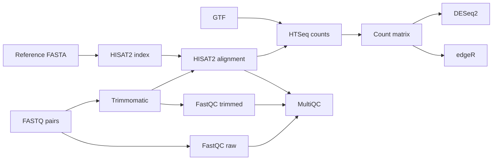

# RNA-seq workflow

A modular Nextflow DSL2 workflow for paired-end RNA-seq, from raw FASTQ QC to differential expression. It uses FastQC, Trimmomatic, HISAT2, samtools, HTSeq, DESeq2 and edgeR. MultiQC combines QC and alignment reports.

## Workflow



## Quick start

Requires Nextflow 24.04 or later, Docker, and an internet connection. The Docker profile uses Nextflow Wave to build and supply containers from the pinned Conda environments.

Run the bundled public test data from a local clone:

```bash
nextflow run . -profile test,docker
```

Run the workflow directly from GitHub with your own samples:

```bash
nextflow run abhijitswain09/NGS-data-analysis -profile docker \
  --input samplesheet.csv \
  --fasta genome.fa \
  --gtf genes.gtf \
  --strandedness reverse \
  --outdir results
```

The default contrast compares `treatment` against `control`. Set `--contrast_reference` and `--contrast_target` if your condition names differ. For this example, the samplesheet must contain both `control` and `treatment` in its `condition` column.

To run from a local checkout, replace the repository name with `.`. The alternative `-profile conda` needs Conda or Mamba installed. Test inputs are small public FASTQ files and reference assets hosted by nf-core/test-datasets.

## Samplesheet

The CSV needs one row per sample and these columns:

```csv
sample,fastq_1,fastq_2,condition
CTRL_1,/data/ctrl1_R1.fastq.gz,/data/ctrl1_R2.fastq.gz,control
CTRL_2,/data/ctrl2_R1.fastq.gz,/data/ctrl2_R2.fastq.gz,control
TREAT_1,/data/trt1_R1.fastq.gz,/data/trt1_R2.fastq.gz,treatment
TREAT_2,/data/trt2_R1.fastq.gz,/data/trt2_R2.fastq.gz,treatment
```

FASTQ paths may be local paths or URLs. Sample IDs must match count-matrix columns. The selected reference and target conditions must both be present.

## Configuration

| Parameter | Default | Description |
|---|---:|---|
| `--input` | required | Samplesheet CSV |
| `--fasta` | required | Reference genome FASTA |
| `--gtf` | required | Gene annotation |
| `--outdir` | `results` | Output directory |
| `--adapters` | bundled TruSeq3-PE | Trimmomatic adapter FASTA |
| `--min_len` | `36` | Minimum read length after trimming |
| `--strandedness` | `no` | HTSeq mode: `no`, `yes`, or `reverse` |
| `--gtf_attribute` | `gene_id` | GTF attribute for gene IDs |
| `--contrast_reference` | `control` | Baseline condition |
| `--contrast_target` | `treatment` | Condition tested against baseline |
| `--padj` | `0.05` | Adjusted p-value / FDR threshold |
| `--lfc` | `1` | Absolute log2 fold-change threshold |

Per-process CPU, memory, and time defaults are in `nextflow.config`. Conda and Docker/Wave profiles are provided. Nextflow writes a report, trace, and timeline under `results/pipeline_info`.

## Outputs

| Directory | Contents |
|---|---|
| `fastqc_raw`, `fastqc_trimmed` | FastQC reports |
| `trimmomatic` | Paired trimmed reads and logs |
| `hisat2_build` | HISAT2 genome index |
| `hisat2_align` | Sorted BAMs, indexes, alignment summaries |
| `htseq_count` | Per-sample gene counts |
| `merge_counts` | Gene-by-sample count matrix |
| `deseq2` | All-gene results and significant/up/down tables |
| `edger` | EdgeR results and diagnostic plots |
| `multiqc` | Combined HTML report |

## Repository layout

```
main.nf                 workflow graph
modules/                one Nextflow process per tool or analysis
bin/                    count-matrix and differential-analysis scripts
assets/                 adapter sequence and public test samplesheet
conf/test.config        small public test profile
.github/workflows/ci.yml stub and end-to-end CI runs
```

## License

MIT. See [licence.txt](licence.txt).
